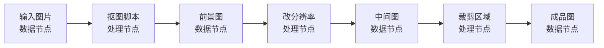
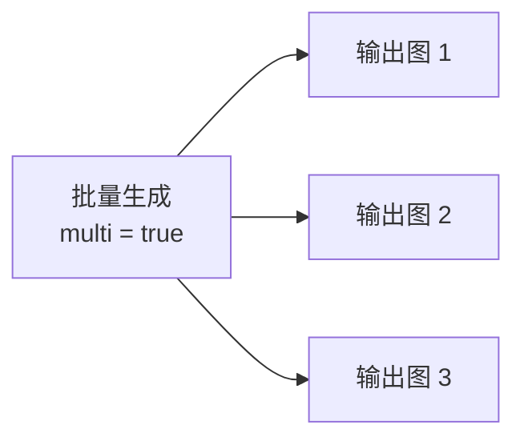
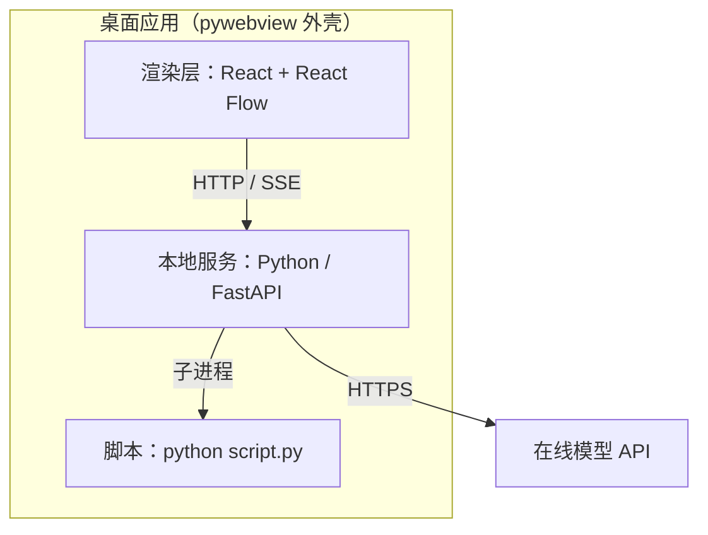

# ImageProcessFlow — 架构与设计讨论

> **最后更新**：2026-10-12
> 标记约定：`[已确认]` = 定稿 · `[暂定]` = 提议未定 · `[待决]` = 需拍板

---

## 1. 需求共识

### 1.1 一句话定义 `[已确认]`

一个**纯本地的可视化流水线编辑器**：在画布上自由摆放节点、连线，把若干图像处理步骤编排成一条流水线，手动逐步运行，得到最终图。

核心不是"编辑一张图"，而是"**编排一组步骤**"。

### 1.2 核心对象 `[已确认]`

| 对象 | 职责 | 备注 |
| --- | --- | --- |
| 画布 | 承载节点与连线的二维工作台 | 可缩放、可拖拽 |
| 数据节点 | 持有数据（图片） | 图的叶节点（源 / 汇），无参数 |
| 处理节点 | 绑定一个脚本算子 | 有输入口、输出口、内联参数控件 |
| 连线 | 表达数据流向 | **只有图片一种类型** |

### 1.3 典型流程

```
输入图 ──▶[抠图 · 在线模型]──▶ 前景图 ──▶[改分辨率]──▶ 中间图 ──▶[裁剪区域]──▶ 成品图
```

### 1.4 参照物 `[已确认]`

形态最接近 **ComfyUI**（以及 Blender 节点、UE Blueprint、Node-RED），可大量借鉴其已有设计。

---

## 2. 架构

### 2.1 数据模型层 `[暂定]`

数据节点与处理节点交替连接，构成一条流水线：



| 维度 | 数据节点 | 处理节点 |
| --- | --- | --- |
| 持有 | 数据本身（图片文件） | 逻辑（脚本引用 + manifest） |
| 参数 | 无 | manifest 声明的输入 + 内联控件 |
| 角色 | 图的源 / 汇 | 图的内点 |
| 数量 | 由产出决定 | 由用户手动创建 |

**节点定义（manifest）** —— 每个脚本携带一份 manifest，前端据此自动渲染节点 UI 并做连线校验。

- `inputs` = **端口**（只有图片一种类型，可连线）
- `params` = **节点上的控件**（文本 / 数字 / 枚举 / 开关 / 区域数组，不可连线）
- `required: false` 的输入口**可以不连线**，节点仍可执行

参数类型目前有 `text` / `number` / `enum` / `bool` / `regions`：

| type | 界面 | 存在 `params` 里的形状 |
| --- | --- | --- |
| `text` | 输入框（多行） | `string` |
| `number` | 数字框 | `number` |
| `enum` | 下拉框 | `string`（选项的 value） |
| `bool` | 复选框 | `boolean` |
| `regions` | **区域预览缩略图 + 编辑器**（见 §3.8） | `[{x,y,w,h}, …]`，原图像素坐标 |

带 `"primary": true` 的参数渲染成节点的**主体区域**（占满中间），其余参数紧凑排在下面。

> 下面这段只是**示意写法**（用来说明 manifest 的形状），不是实际落地的节点。真正的 `resize` 节点见 §3.9 —— 动态输入口、`multi: true` 输出，且**没有** `mode`（只做强制拉伸）。

```jsonc
{
  "id": "resize",
  "name": "调整分辨率",
  "entry": "resize.py",
  "inputs": [
    { "key": "image", "type": "image", "required": true }
  ],
  "params": [
    { "key": "width",  "type": "number", "default": 1024 },
    { "key": "height", "type": "number", "default": 1024 },
    { "key": "mode",   "type": "enum",   "default": "cover",
      "options": ["stretch", "cover", "contain"] }
  ],
  "outputs": [
    { "key": "image", "type": "image", "multi": false }
  ]
}
```

**多输出**：`outputs[].multi = true` 时，脚本运行完成后按**实际产出的数量**动态生成 N 个数据节点。



**连线类型与端口基数** `[已确认]`

- 连线**只有一种类型：图片**。文本 / 数字等参数**不做成端口**，直接在处理节点上填写。
- **每个输入口一对一** —— 一个口只能接一个来源，不支持 fan-in。
- **输入口数量可动态增减** `[已确认]` —— manifest 里把输入声明为 `dynamic`；节点实例的**每个输入口行右侧有 `−`**（删掉这一个，删哪个一目了然），**最后一行下方有 `＋`**（在末尾新增一个）。引擎按当前数量把端口展开成 `image1`、`image2`…，同时给出**序号 `num`** 供界面显示（界面只显示序号，完整名在 tooltip 里，见 §2.4）。
- **删除 = 摘掉 + 后面整体前移** `[已确认]` —— 端口是按数量展开的，所以删掉中间的「参考图2」等价于「数量 −1，且它后面的端口前移一格」：原本挂在「参考图3」上的连线会改挂到「参考图2」上。**提示词里写的序号不会跟着改** —— 用户自己改（见 §2.4）。
- 一个输出槽位可 **fan-out** 到多个下游处理节点。

---

### 2.2 执行模型层

#### 2.2.1 核心规则 `[已确认]`

> **作用域**：以下所有规则都在**当前画布内部**生效。画布之间完全独立 —— 不级联、不共享脏标记、也不跨画布连线（把一个画布的子图搬到另一个画布走「复制 / 粘贴」，见 §2.6）。

**R1 — 参数改动不等于执行。** 改参数只改变配置，不触发任何重算，对下游无影响。

**R2 — 执行是显式动作。** 执行处理节点 `P` 后：
1. `P` 按新结果重新生成自己的全部输出槽位；
2. `P` 的**直接下游数据节点**立即失效，并随新输出一起被重新生成，且仍连着下游处理节点。

> 以 `P₁ → D₁ → P₂ → D₂` 为例：改 `P₁` 参数无影响；执行 `P₁` 后 `D₁` 失效并重建，`D₁` 依然连着 `P₂`。

**R3 — 数据节点是「输出槽位」的投影，不是独立实体。**
画布上一条 `D → P₂` 的连线，真实语义是：

```
(生产者处理节点, 输出序号 idx) → (消费者处理节点, 输入口)
```

数据节点只是"某处理节点第 idx 个输出"的可视化身，生命周期完全由上游处理节点决定。因此重执行时比对的是**序号**，而非节点本身。

**R4 — 重执行后按「输出序号」重新绑定下游连线。**

| 情况 | 结果 |
| --- | --- |
| `idx < N_new`（序号仍存在） | 连线**保留**，自动指向新输出的第 `idx` 张 |
| `idx >= N_new`（序号不存在） | 连线**断开**，该输入口空置 |

> 例一：原输出 1 张、`P₂` 连 `#1`；重执行后输出 2 张 → `P₂` 仍绑定 `#1`，新增 `#2` 无下游。
> 例二：原输出 2 张、`P₂` 连 `#2`；重执行后只输出 1 张 → `#2` 不存在，`P₂` 断开。

**R5 — 脏标记只作用于直接下游，不递归传递。**

```
执行 P₁ ──▶ D₁ 失效重建 ──▶ P₂ 标脏（停止）
执行 P₂ ──▶ D₂ 失效重建 ──▶ P₃ 标脏（停止）
```

即：`D₂` 不会失效，`P₃` 不会被标记。脏标记随执行**逐级推进**。替换输入图同理 —— 等价于给该数据节点的直接下游处理节点打脏标记。

#### 2.2.2 执行细节约定 `[已确认]`

- **执行粒度**：执行 `P` 只跑 `P`，无自动级联；所有处理节点都必须**手动执行**。
- **数据节点身份**：**原地刷新** —— node id 与画布坐标均保持不变，下游连线无需重写。
- **槽位消失**：输出变少时，多余的数据节点**直接移除**，相连的下游输入口断开。
- **新槽位落点** `[已确认]`：放在**处理节点右侧一列**，纵向按序号排开。偏移量**按节点实际尺寸推算**，而不是写死的常量 —— 早期写死 `380 / 210`，那是按 280 宽的处理节点算的，节点一被调大（默认已到 560~600 宽、数据节点 220 高）输出就会横向压住上游、纵向互相压。
  - **横向**：`x = 处理节点 x + 该节点实际宽度 + 64`；宽度取 `max(设置里该类型的最小宽度, 节点存过的 w, manifest 的 defaultWidth, 600)`。
  - **纵向**：**逐个累加，间距 = 上一个数据节点的实际高度 + 10**（`y₀ = 处理节点 y`，`yᵢ = yᵢ₋₁ + hᵢ₋₁ + 10`）。不是「序号 × 一个固定间距」—— 一组里高低不一时，固定间距要么把矮节点之间撑开一大截，要么让高节点互相压住。
    - `SLOT_GAP_Y = 10` 这个值是按**用户手动排布时实际用的缝隙**定的（手拖出来的三处是 9.99 / 7.92 / 12.06，取整就是 10）。早期的 30 偏大：数据节点 180 高时，30 的缝在视觉上已经算"隔了一层"。
  - **实际高度**与前端算法**必须一致**：口径只有一份 —— `server/nodespec.py` 的 `size_of()`，而 `/api/state` 下发的 `w`/`h` 就是它算出来的，前端拿去直接渲染（§3.5.1）。**任何要问「这个节点多大」的代码都走它**，不要另写一份。
  - **只在新建槽位时使用**：已有槽位的位置不会被执行改动（用户手动拖过就尊重用户）；但往下累加的游标要按**已有节点自己的位置和高度**走，否则在拖过的节点之后新增槽位会压在一起。
  - **踩过的坑（一）**：这里曾经写成 `max(设置下限, RESOURCE_DEFAULT_H=280)`，等于**永远按 280 排**。用户把数据节点调矮到 180 之后（`nodeMin.resource.h = 180` 是很自然的设置），间距仍是 `280+30=310`（当时 `SLOT_GAP_Y` 还是 30），于是每两个节点之间空出 **130px** 的真空隙 —— 明明「留一点点缝」就够了。测试见 `runtime/verify_slots.py` 里 `resource_height` 那几条（「存了 h=180 → 实际高 180」）。
  - **踩过的坑（二）**：那个 `280` 还和**前端**的默认高度 `220` 对不上（`App.jsx` 的 `RESOURCE_SIZE.h`）。因为节点尺寸**只在拖过右下角手柄时才写进 graph.json**，没拖过的节点每次渲染都要现算 —— 两边各算一份就必然漂移：服务端按 280 排槽位、屏幕上渲染的是 220，于是每两个输出节点之间**多出 70px 的假缝**。实测某张真实画布 34 个数据节点里 **17 个**没存过 `h`，也就是说这事影响**半个画布**。现在尺寸常量只剩 `nodespec.py` 一份，前端一个数字都不写（§3.5.1）。
  - 历史画布如果已经被摆歪（含上面这个坑留下的空隙），用**画布右键 → 画布 → 格式化所有节点**一键收拾（对应 `POST /api/format`，§3.11）。
- **执行失败**：**保留旧输出** + 节点标记 `error`；「变少即断线」在失败时不生效。
- **缓存**：**不复用**，每次真实执行（真的调用在线模型 / 真的跑脚本）。
- **执行耗时** `[已确认]`：引擎实测子进程全程的墙钟时间（含模型调用与图片下载），记在节点的 `lastDuration` 上供界面显示。不解析脚本日志，因此对任何脚本都通用。
- **替换输入图**：等价于给直接下游打脏标记。

#### 2.2.3 其余机制 `[暂定]`

- **异步**：生图要 10~60 秒，界面不能卡死。节点状态机 `idle → dirty → pending → running → done / error`。
- **图约束**：DAG，禁止环。

#### 2.2.4 推论：不存在"模型节点"，只有"执行脚本的节点" `[已确认]`

"调用在线模型"本身也就是执行一个脚本。据此：

- 节点类型只有一种：**处理节点 = 执行一个脚本**，没有独立的"模型节点""AI 节点"。
- 脚本内部既可能做本地像素运算，也可能请求在线模型；**对执行引擎没有区别**。
- 因此"在线模型调用"**不是一种节点**，而是脚本内部的一次普通 HTTPS 请求。

---

### 2.3 运行架构 `[已确认]`

**纯本地 + Python 为主**：所有组件都运行在用户本机上。唯一的对外流量是脚本主动发起的在线模型 API 请求。



要点：

- **Python 是主语言** —— 脚本调度、工作目录读写、原生对话框、模型调用全在 Python 侧。
- **脚本以子进程执行** —— 参数走 stdin JSON、结果走 stdout JSON。脚本崩溃 / 死循环不会拖垮主程序，且可设超时。
- **前端只在构建期需要 Node**（Vite），运行时不需要。
- **原生对话框由 Python 侧提供**（pywebview `create_file_dialog` 或 tkinter）。因此**开发期可用浏览器直连 FastAPI、交付期套 pywebview 壳，后端代码完全共用**，不需要额外的抽象层。
- **在线模型调用**：脚本内直接发起 HTTPS 请求（如 DashScope），密钥从环境变量读取。v1 只有一个生图脚本，暂不做共享 SDK。

**双模式：同一份代码，两种打开方式** `[已确认]`

| 方式 | 启动 | 用途 |
| --- | --- | --- |
| 浏览器 | `uvicorn` 起服务，打开 `127.0.0.1:8000` | **开发期** —— 前端热更新、后端自动重启，调试最方便 |
| pywebview 窗口 | `python main.py` | **日常使用** —— 独立窗口、无地址栏、有图标、可固定任务栏 |

两者共用同一份前端与后端，业务代码零差异；桌面壳只是最后加的一个入口文件。因此**开发全程用浏览器即可，桌面壳可以推迟到最后，甚至不做**。

> 澄清：即使通过浏览器打开，它也**不是"网站"** —— 服务只监听 `127.0.0.1`，不对外开放，文件与脚本都在本机 Python 侧处理。

**脚本注册** `[已确认]`：不需要"上传代码"。新增一个脚本 = **在本地脚本目录放一个 `.py` + 更新对应 manifest**，之后即可在画布上使用。

---

### 2.4 工作目录与文件 `[已确认]`

工具启动时需要**指定一个工作目录**；此后所有文件操作都被限制在该目录内 —— **绝不操作工作目录以外的文件**。

| 动作 | 实质 |
| --- | --- |
| 从外部拖入图片作为数据节点 | 把该图片**复制一份**到工作目录，之后都基于副本处理 |
| 处理节点产出图片 | 由脚本写入工作目录 |
| 「下载」（导出） | 把工作目录里的图片**复制**到用户指定的其他位置（不是真的下载） |

要点：

- 数据节点（无论输入型还是输出型）都对应工作目录里的一个文件。
- **输入型**数据节点由用户提供文件；**输出型**数据节点是处理节点输出的投影（见 R3），文件由脚本写出。
- 画布结构（`graph.json`）也在工作目录里 —— 因此**打开工作目录 = 打开项目**，无需单独的"保存 / 加载项目"功能。

**目录布局** `[已确认]`（v2：一个工作目录里可以放多个画布，见 §2.6）

```
<工作目录>/
├─ graph.json                    画布容器 {version:2, current, canvases:[{id,name,viewport,…}]}
├─ canvases/
│   └─ <画布id>/
│       └─ images/               这个画布自己的图片池，文件名主干即图片名
│           ├─ A.png
│           └─ B.png
├─ .tmp/                         执行中的临时输出，成功后搬运到对应画布的 images/
│   └─ <runId>/
└─ .trash/                       删除中转站，后台会自动清空（两个画布共用；内容都是瞬态的）
```

- 只有**一个** `graph.json`，所有画布的节点/连线/参数/视野都在里面 —— 单一原子写点，没有索引文件要同步。
- **图片池按画布分**（`canvases/<id>/images/`），所以短名只在本画布内唯一：两个画布各有一个 `A` 是正常的。
- `.tmp/` 与 `.trash/` 是工作区级的（内容都是瞬态的），不按画布分。
- **老的 v1 工作目录**（顶层一个扁平 `graph.json` + 顶层 `images/`）在第一次打开时自动迁移：老画布成为「画布 1」，顶层 `images/` 里的文件整体挪进它的池子。

**图片命名** `[已确认]`

- 每张图片（无论来源是外部拖入还是节点产出）在**本画布内**有唯一短名，默认自动分配 `A`、`B`、`C`…（用尽后 `AA`、`AB`…），取本画布内未被占用的最小名字。
- **文件名主干 = 图片名**（`canvases/<画布id>/images/A.png`），用户在工作目录里能直接对上号。
- 名字显示在数据节点上。图片名一经分配**不随重执行改变** —— 原地刷新的槽位保留原名，新增槽位分配新名，消失槽位的名字被释放。
- 图片名**只用于标识文件和节点**（缩略图徽标、删除确认框点名等），**不参与提示词**。

**提示词里怎么指代输入图** `[已确认]`

提示词**原样传给脚本，引擎不做任何隐式改写**。要引用某张输入图，照节点**输入口栏里的序号**写成「参考图N」：

```
节点输入口栏                提示词里写
   ● 1  −         ←──→      参考图1
   ● 2  −         ←──→      参考图2
      ＋
```

> 输入口栏里**只显示序号**（`1`、`2`…），省地方；完整名字（`参考图1`）以及它当前连的图片名在**鼠标悬停的 tooltip** 里。
> 提示词「把参考图2中的人物放到参考图1的背景里」→ 原样发出，就是这串字。

所以规律是**序号对齐**：输入口栏第 N 行 ↔ 提示词里的「参考图N」。代价是提示词与"插在哪个口"绑定 —— 调整接线后要自己回去改提示词。

> 早期版本做过「图片名 → 第 N 张参考图」的自动替换（写 `A` 也能用，且跟着图走）。已移除：省掉一层隐形转换，提示词里写什么、模型就收到什么，排错时可以直接对照。

**清理规则** `[已确认]`：**画布内**的文件与该画布的状态**严格对应**，本画布不再引用的文件就是垃圾，一律**永久删除**（不进回收站）。因为图片池是按画布分的，删一个画布的图**永远不会**动到别的画布 —— 这也是选「每画布一份图片池」的主要好处。触发情形：

- 重执行后输出变少，多出来的槽位文件被删除（对应 R4 / C4）
- 用户手动删除数据节点
- 替换输入图时，旧的副本被删除

> 执行**失败**时不触发清理 —— 输出先写临时目录，成功后才会搬运到位（见 2.5）。

**删除为什么分两步** `[已确认]`

实测（Windows + 文件系统过滤驱动）：

| 操作 | 耗时 |
| --- | --- |
| `unlink` 删除文件 | **~370 ms**，且**与文件大小无关**（2 KB 与 3 MB 一样慢） |
| 同卷 `rename` 改名 | **~0.7 ms** |

差 500 倍。所以 `delete_image` 只做 rename：

1. 文件被 `rename` 进 `.trash/`（~1 ms）—— 请求立即返回，画布上的节点瞬间消失
2. 后台线程（`purge_trash`）再逐个 `unlink`，把 `.trash/` 清空

接口耗时从 **~440 ms 降到 ~8 ms**。语义不变：文件最终仍被**永久删除**，只是延后几百毫秒，`.trash/` 只是中转站。启动时、以及每次删除/导入/执行之后都会触发后台清理。

---

### 2.5 脚本契约 `[已确认]`

处理节点 = 执行一个脚本。为了让引擎对任何脚本都用同一套调用方式，约定如下：

**调用**：`python <scripts>/<entry>`

**stdin（引擎 → 脚本）** —— 一行 JSON：

```jsonc
{
  "params":     { "prompt": "一只戴墨镜的橘猫", "n": 1 },   // 节点上填写的参数，原样传递（含提示词）
  "inputs":     { "image1": "/abs/workspace/images/A.png",  // 未连线的输入口为 null
                  "image2": null,
                  "image3": null },
  "output_dir": "/abs/workspace/.tmp/<runId>"
}
```

**stdout** —— 脚本自由输出日志，原样显示在节点上。

**产出** —— 脚本把产生的图片写进 `output_dir`，命名为 `0.png`、`1.png`…；**文件名序号即输出槽位顺序**，引擎直接扫描该目录得到输出个数。

**成功 / 失败** —— 退出码 `0` 为成功；非 `0` 为失败，错误信息写 stderr。

**原子搬运** —— 脚本先写临时目录，成功后引擎才把它搬到 `images/<图片名>.<ext>`。因此：

- 失败时旧输出**原封不动**（满足 C5）
- 成功后按 R4 重新绑定槽位

没有结果 JSON、没有回调、没有进度协议 —— 引擎只关心「**退出码 + 目录里有什么文件**」。

---

### 2.6 多画布 `[已确认]`

**一句话**：工作目录是「项目」，画布是项目里的一个**独立 DAG + 独立图片池**。一个画布专注做一件事，不用把几十个节点挤在一张画布上。

| 维度 | 归属 |
| --- | --- |
| 节点 / 连线 / 参数 / 输出槽位 | **画布**：各画布一份，互不可见 |
| 图片池（短名 A、B、C…） | **画布**：`canvases/<画布id>/images/`，短名只在本画布内唯一 |
| 缩放 / 平移（视野） | **画布**：切回来自动恢复，不用重新找位置 |
| 脚本注册表 / 设置（`settings.json`）/ `.tmp/` / `.trash/` | **工作目录或应用**级，所有画布共用 |
| 执行 / 脏标记 / 整图排版 / 网格吸附 | 只作用于**当前画布**（吸附在落盘时会顺带收所有画布，反正都在内存里） |

**存储**：所有画布都放在**一个** `graph.json` 里（`{version:2, current, canvases:[…]}`）。
好处是写入始终是一次原子替换、没有「索引与正文不一致」这种状态；代价是文件随画布数增长（一个画布几十个节点大约几十 KB，可以忽略）。

**内存模型**（这是这次改动能做到「引擎几乎不用改」的原因）：

- `STATE["doc"]` = 整份文档；`STATE["graph"]` 指向 `doc.canvases` 里**当前画布那个 dict 本身**（同一个对象，不是副本）。
- 所以满地的 `g = graph()` + 就地改字段照旧生效；**切画布只是换个引用**，不需要重载或迁移。
- 图片池不再是「工作区的一个目录」，而是由 `Workspace.view(canvas_id)` 给出的 `CanvasView`。引擎（`execute` / `remove_process` / `remove_resource_node`）接收的就是它 —— 引擎不需要知道工作区里有几个画布，`ws.delete_image(name)` 天然只动**本画布**的文件。

**取图必须带画布 id**：`GET /api/images/<画布id>/<名字>`。
两个画布各有一个 `A` 是正常的，少了这个 id 就会把别的画布的 `A` 送出去（浏览器里 `` 还可能在切画布的一瞬间发旧请求）。不带 id 的老路由保留，只在当前画布内找。

**复制 / 粘贴（跨画布搬节点）** `[已确认]`：

- 剪贴板在**服务端内存**里（不是让浏览器揣着图片数据来回传），因为它要干一件浏览器干不了的事：
  把图片文件从源画布的池子**复制一份**进目标画布，并在目标画布**重新分配短名**。
- 复制：右键 →「复制选中的节点」，或 `Ctrl+C`（只拷选中的节点，以及它们之间的连线）。
- 粘贴：右键 →「粘贴到此处」（落在右键位置），或 `Ctrl+V`（落在**视野中心** —— 跨画布粘贴时原坐标很可能在新画布视野外）。
- 处理节点的参数 / 端口 / 尺寸照抄，但**运行状态清零**（status / dirty / error / lastRun）。
- 「谁产出了谁」只在**生产者也一起被复制**时才保留；否则那张输出图退化成一张普通的输入图（不然会留下一个指向不存在处理节点的 producer）。

**界面**：顶栏左侧「工作目录」方块旁边是画布分段控件 —— `画布 [画布 1 ▾] ＋ ✎ ⋯`，切换后画布立刻重建。`＋`（新建）与 `✎`（重命名）**并排同级**：新建完通常紧接着就要改名；只有 `删除` 收在 `⋯` 里（低频，且是破坏性的）。下拉列表**是自己画的**，不是 `<select>` —— 原生弹层由平台渲染（Windows 上是浅色菜单），`color-scheme` 与 `option` 的样式都管不住，弹出来是白底配我们这身浅色文字。
删除画布会**连它的图片池一起永久删除**（确认框会点名它有几个节点），**最后一个画布不给删**（用 400 顶回去，按钮也是禁用的）。

**为什么不是「共享一个图片池」** `[已确认]`：共享的好处是同一素材不用复制、删除规则要改成「整个工作区都不再引用才删」；
但那样「画布」就不再是自包含的了 —— 删一个画布可能把另一个画布还在用的图删掉，跨画布粘贴也只是「换个节点引用」，
和「一个画布专注一件事、可以整个丢掉重来」的直觉冲突。**每画布一份**更简单、更安全，代价只是同一素材在多个画布用时会多占几份磁盘。

---

## 3. 技术做法 `[暂定]`

**界面层**
- React + React Flow（Vite 构建；Node 只在构建期需要）
- 节点渲染由 manifest 驱动：通用节点组件 + 按 `type` 分发的参数控件

**本地服务（Python）**
- FastAPI 提供 HTTP + SSE，负责执行状态与日志推送
- 脚本调度：以子进程执行（协议见 §2.5）
- 工作目录读写：所有文件操作在此收口，实现目录沙箱
- 原生对话框：pywebview / tkinter

**桌面外壳**
- pywebview（Windows 走 WebView2）。开发期直接用浏览器，交付期套壳

**目录结构**

```
ImageProcessFlow/
├─ web/            前端（React + React Flow + Vite）
├─ server/         Python 本地服务
│   ├─ main.py         路由 + SSE 日志推送
│   ├─ workspace.py    工作目录 / graph.json / 图片名分配
│   ├─ registry.py     脚本注册表（扫描 scripts/*/manifest.json）
│   ├─ engine.py       执行引擎
│   ├─ nodespec.py     **节点尺寸的唯一事实来源**（§3.5.1）
│   ├─ polish.py       提示词润色（调用 DeepSeek）
│   └─ static/         前端构建产物
├─ scripts/        脚本（.py）+ 各自的 manifest
├─ MODEL_NOTES.md  各生图模型的使用特点（供润色参考）
├─ settings.json   应用级设置（运行时生成）
└─ runtime/        venv / 缓存 / 测试脚本（不是工作目录）

（工作目录由用户在运行时指定，位于上面这棵树之外）
```

### 3.4 实施范围 `[已确认]`

**已有的处理节点**：`Qwen 生图 / 编辑`（§3.4 下方）、`裁剪`（§3.8）、`调整分辨率`（§3.9）、`区域抹除`（§3.12）、`按透明度抹除`（§3.13）；另有 `正方形扩展` / `单色替换` / `Alpha 缩放` 三个多输入几何节点（未单列小节，说明见 [`README.md`](README.md)）。引擎的通用能力（多输出、槽位重绑定、失败保留旧值）全部按 §2.2 实现，**加节点不需要改引擎** —— 只需写脚本 + manifest。

**节点定义：Qwen 生图 / 编辑**

脚本参考现有 QwenImageGen 封装（`qwen_image_gen.py`）改写为节点脚本：命令行参数换成 stdin JSON，`--output` 换成写入 `output_dir`。

*输入口*（**动态**，节点上用 −/＋ 增减数量）

| 声明 | 展开结果 |
| --- | --- |
| `{ "key": "image", "dynamic": true, "count": 1, "min": 0, "max": 10 }` | 数量由节点实例的 `ports.image` 决定，端口为 `image1`、`image2`… |

**全部为空 = 文生图**；有连线 = 图生图 / 编辑。脚本按端口顺序把非空输入依次传给 API —— `image1` 作为第 1 张，也就是提示词里写的「参考图1」（端口标签 = 提示词用词，见 §2.4）。

*参数*

| key | 类型 | 默认 | 说明 |
| --- | --- | --- | --- |
| `prompt` | text | — | 正向提示词或编辑指令（必填）。节点上以 `primary: true` 标记，占据主体位置 |
| `model` | enum | `qwen-image-2.1-turbo` | 另可选 `qwen-image-2.1-pro` / `qwen-image-3.0` / `qwen-image-3.0-pro` |
| `size` | enum | `""`（自动） | 可选 `720x1280` / `1024x1024` / `1280x720` / `1024x1536` / `1536x1024` / `1536x1536`；空 = **按参考图就近选一个预设**（见下） |

> **尺寸的分隔符坑** `[已确认]`：DashScope 要求 `720*1280` 这种**星号**写法，写成 `720x1280` 会被拒：
> `{"code":"InvalidParameter","message":"Expected format: '<width>*<height>'"}`。
> manifest 里仍写成人类可读的 `x`，**脚本发送前统一归一化**（`x` / `X` / `×` / `*` 都能吃）。
> 面积需落在 `512x512`(262144) ~ `2560x2560`(6553600) 之间，**图生图上限更低（2048x2048）**，所以预设值都控制在这个范围内。
| `n` | number | 1 | 生成张数（每张计费） |
| `transparent` | bool | false | 追加透明背景要求 |
| `prompt_extend` | bool | false | 提示词智能改写（编辑任务建议关闭） |
| `watermark` | bool | false | 添加水印 |

**尺寸「自动」的语义** `[已确认]`（2026-10-12）

下拉里的「自动」**不是**「让模型自己挑」，而是「**按参考图就近选一个预设**」：

1. 取**最后一张**连了线的参考图的宽高，当成向量 A —— DashScope 的口径就是「多图输入时取最后一张」，
   所以这里必须用最后一张，不能取第一张；
2. 把每个能解析成宽高的选项也当成一个向量，和 A 一起**归一到同一面积**（`REF_AREA = 1024×1024`）；
3. 取归一化后**欧氏距离最近**的那个；距离打平时（`1024×1024` 与 `1536×1536` 是同一个比例）
   用**面积比**兜底，所以 `1024×1024` 的输入会回到 `1024×1024`。

命中的选项会**原样发给 API**（等于帮用户把「自动」落成一个显式选择），所以它是**可预测、可复现**的；
并且会**在生成之前**显示在节点上 —— 尺寸下拉下面一行 `自动 → 720×1280`，悬停能看到依据的是哪张参考图。
不用等生成完才发现模型挑了一个完全不同的分辨率。

> **为什么必须先把面积归一化**：直接拿 `(720,1280)` 和 `(1024,1024)` 算欧氏距离，那个距离里同时混了
> 「形状」和「大小」两件事，会被大面积选项带偏。实测反例：输入 `941×1672`（比例 0.5628，一张 9:16 的竖图），
> **不归一化**选 `1024×1536`（比例 0.667），**归一化后**选 `720×1280`（比例 0.5625，差 0.0003）——
> 后者才是对的。归一化之后两者面积相同，剩下的差异**就只剩形状**了，而「像不像」本来就是形状说了算。
> 这条反例被钉在 `runtime/verify_autosize.py` 里当断言，改算法会被它挡住。

> **为什么不继续用「不传 size」来实现自动**：不传 size 时输出分辨率完全由模型定，
> 实测输入 `720×1280` 出来是 `1536×2720` —— 宽高比是对的，但面积被放到 **4.5 倍**（线性 2.13 倍），
> 而且用户既无从预知、也无从复现（见 `MODEL_NOTES.md`）。「尺寸选项里有 720×1280，却怎么都输出不了 720×1280」
> 就是这么来的：**选了「自动」等于没选尺寸**。

**无参考图 = 交回模型**：文生图没有向量 A，此时不解析、不发 `size`，节点上显示「自动 → 模型自选」。
不硬塞一个 `1024×1024`，那等于凭空替用户做掉模型本来会做的那个决定。

**实现只有一份** —— `server/autosize.py`：

| 函数 | 谁在用 | 口径 |
| --- | --- | --- |
| `pick()` | `main._auto_size_hint()` → `/api/state` 的 `autoSize` | **与用户当前选了什么无关**，纯算「自动会落到哪」 |
| `resolve()` | `engine.execute()` | 用户显式选了就**尊重用户**，没选才走 `pick()` |

- **显不显示提示是前端的事**：`/api/state` 一律下发 `autoSize`，前端按本地 `params` 判断要不要显示。
  因为参数改动走**防抖 PATCH、不回灌 state**（§3.5 的 `pushParam`）—— 要是等服务端回来，
  「选了显式尺寸提示却不消失」会卡好几秒，反过来切回「自动」时提示也回不来。
- **执行时把它当成用户显式选的**塞进 `params` 再交给脚本 —— 脚本那边完全不需要知道「自动」这回事，
  它只有「有 size 就发、没有就不发」这条老逻辑（§2.2.4 的「节点=执行脚本」的延续）。
  执行日志里会打一行 `[尺寸] 自动 → 720×1280（依据 参考图1 720×1280）`。
- **只算不写**：`graph.json` 里的 `params.size` 始终是空串，和 §3.5.1「尺寸是算出来的、不是存下来的」同一个原则。
- 两处（界面 / 执行）必须同口径，否则显示的和真正发出去的会是两个值 —— `runtime/verify_autosize.py` 里有直接断言。

**manifest 怎么声明**：参数上加 `"autoFrom": "input"`。没声明的 enum 参数一律不参与
（裁剪节点就没有，所以它不会多出提示行）。选项里解析不出宽高的（那个空值「自动」）自动排除。


**节点 UI 的渲染约定**：`primary` 参数渲染成节点主体（大输入框）；其余 `enum` / `number` / `bool` 参数紧凑排在主体下方。每个参数可以声明 `width` 决定它占多宽：

| `width` | 效果 | 用在 |
| --- | --- | --- |
| `grow` | 吃掉整排剩余宽度（下限 190px） | `model`（名字最长，需要宽度） |
| 不写 | 定宽 148px | `size` |
| `narrow` | 定宽 78px | `n` |
| `full` | 独占一整排 | 备用 |

一整排（`full`）除外，其余按 `flex-wrap` 自然折行：**宽度够就挤在一排，不够才折到第二排**。因为「模型」字段最宽，提示词节点的最小宽度定在 560，所以配置区在最小宽度下就是**两排**（模型/尺寸/张数 · 三个开关），拖宽到 620 以上会自动收成一排。manifest 里**不写 `hint`** —— 低频说明不占 UI 空间，统一放文档。

*输出*：`multi: true` —— `n > 1` 时产生多个输出槽位。

**"抠图"怎么做**：靠 `prompt` 文本描述（例如「抠图编辑：只保留 X 和 Y，其余全部删除」式的明确枚举），配合 `transparent` 打开透明背景。**v1 不做图上框选。** 注意：提取背景时不要用"抠图"字眼，改写为「仅保留背景」，避免产生错误的半透明效果。

**API Key**：沿用环境变量 `DASHSCOPE_API_KEY`。

### 3.5 画布交互约定 `[已确认]`

| 操作 | 行为 |
| --- | --- |
| **创建节点** | 在画布**空白处点右键**打开菜单，选处理节点或导入图片（数据节点）。节点落在右键的位置 |
| **拖动节点** | 只有按在节点的**空白区域**（标题栏、输入口行、各区块间的留白）才会拖动。按在输入框 / 下拉框 / 复选框 / 按钮上不拖动，也不平移画布 —— 实现上给这些元素加 React Flow 的 `nodrag nopan` 类 |
| **提示词框** | 用**非受控** textarea（`defaultValue` + ref，只在**未聚焦**时把外部值同步进 DOM）。**不要改回受控**：中文输入法在组合（拼拼音）期间 Chrome 会持续触发 `input` 事件，受控组件会把 state 回写进 DOM，浏览器认为内容被外部改动 → 直接掐断当前组合，表现为「打到 `sh` 就被定格成字母、拼音断掉」 |
| **删除节点** | 选中后按 `Delete` 或 `Backspace`，效果与节点上的「删除」按钮**完全一致**（共用同一条路径）。在输入控件里按键不会误删 |
| **删除确认** | 只有**直接删除数据节点**时才可能弹 —— 它是唯一对应磁盘文件、会真正丢东西的操作。删处理节点和连线一律**静默执行**。弹框时会点名列出将要永久删除的图片。是否真的弹由**设置项**决定（默认开，见 §3.6） |
| **删除入口** | 只有键盘 `Delete` / `Backspace`（配合选中）。节点上**不再有删除按钮** |
| **增减输入口** | 每个输入口行右侧的 `−` 删除**这一个**；输入口栏最下方的 `＋` 在末尾新增一个。删掉中间的端口后，其后的端口依次前移（`参考图3` → `参考图2`），连线跟着前移 |
| **调整节点大小** | 拖节点**右下角的小方块**。位置与尺寸都会被记进 `graph.json`，刷新后保持。手柄固定待在节点右下角，所以 `node-foot` 底部特意留了 18px 空带（否则手柄会压在「执行」按钮上） |
| **节点显示的信息** | 一律放**标题栏右侧**，不占节点主体：数据节点显示**分辨率与格式**（`941×1672 · PNG`，服务端读文件头得到，不落盘）；处理节点显示状态与**上次执行耗时** |
| **选中节点的信息** | 画布**左上角**常驻一块小浮层，显示当前选中节点的基础数据（目前只有**宽 × 高**）。从节点状态里现取，所以拖手柄时是实时跳动的；没选中任何节点时整块隐藏 |
| **看大图** | **双击数据节点**打开全屏查看器（缩略图太小，抠图这种活必须能放大看）。默认「适应窗口」，可切「实际大小」（1:1，超出就滚动），**双击图片本身**也能切换；透明区域下面垫**棋盘格**，一眼能看出哪里被抠掉了。关闭方式：`Esc` / 点暗处 / 「关闭」按钮。处理节点双击无反应 |
| **格式化所有节点** | 画布右键 →「画布 → 格式化所有节点」：**整张画布**重新排版 —— 处理节点、输出节点、输入图全都参与。分层列布局，见 §3.11 |
| **撤销格式化** | 画布右键 →「画布 → 撤销格式化」：把节点坐标还原到格式化**之前**。每个画布留一份快照（内存里，重启清空），**只能用一次**；没格式化过时这一项是灰的 |

**处理节点的内部布局** `[已确认]`：**左栏只放输入口，其他所有东西都在右栏**，中间一条竖分隔线。左栏撑满节点剩余高度，所以输入口有多少都不额外占高度。

```
● Qwen 生图 / 编辑              已完成 · 9s
┌────────┬──────────────────────────────────┐
│ ● 1  − │  ┌──────────────────────┐ ┌────┐ │
│        │  │  提示词（撑满）        │ │润色│ │
│    ＋  │  └──────────────────────┘ └────┘ │
│        │  模型 …   尺寸 …   张数 …          │
│        │  ☐透明底 ☐改写 ☐水印              │
│        │  ▶ 执行                           │
└────────┴──────────────────────────────────┘
```

- 左栏宽度写死 **70px**，行内就三样：**连线圈 · 序号 · `−`**。整个左栏是紧凑的：行字号 10.5px、序号 11px、圈 10px、`＋/−` 按钮 17×17px。
- **两侧的连线端点钉在标题栏正下方**，与左栏**第一个输入口同高** —— 一律不用 React Flow 默认的 `top: 50%`（那样端点会落在节点腰部，线斜着钻进左栏顶部那一列输入口，怎么摆都看着不齐）。
  - 位置由 `:root` 里三个变量推出：`top = calc(--head-h + --ports-pad-top + --port-row-h / 2)` = 35 + 6 + 10.5 = **51.5px**。别在 CSS 里手写魔数。
  - 只作用于**直属 `.node` 的**端点（处理节点右侧的输出口、数据节点左右两个口）。左栏里的端口是 `position: static`、走行内布局，天然就在这个基线上，不需要动。
  - 输入口行因此设了 `min-height: var(--port-row-h)`（21px）：裁剪节点那个无名口既没有 `−` 也没有序号，行高只有 14px，不兜住的话它的圈会比其他节点**高 3.5px**，右侧端点又跟它对不齐了。
  - 两侧的圈统一 **10px**（原来是 9px）：尺寸不一致时圆心会因为半个像素的取整差 ~0.3px，放大后看得出来。
- **提示词框与「润色 / 撤销」左右并排**，按钮贴在这一行的**底部**（`align-self: flex-end`）；出现「撤销」时两个按钮在这一列里上下叠放。
- 输入口**不显示图片名**（省地方），名字和它当前连的图片名放 **tooltip**（悬停可见）。
- 输入口很多时左栏内部**自己滚动**，不会把节点撑破。
- 之所以这么改：竖着堆叠时输入口栏会独占一整条横向空间、提示词再占一条，等于白扔半屏；现在左栏是"一条窄边"，右栏拿到几乎整个宽度。

> 实时输入口 −/＋ 见 §2.1；提示词如何指代输入图见 §2.4。

### 3.5.1 节点尺寸 `[已确认]`

节点是**固定尺寸**的（不是内容撑开），可以拖右下角的小方块改大小。

#### 尺寸只有一条计算路径 `[已确认]`

尺寸原先在**两个地方各算一遍**（前端 `App.jsx` 的 `RESOURCE_SIZE` / `PROCESS_SIZE`，服务端 `engine.py` 的 `PROCESS_DEFAULT_W` / `RESOURCE_DEFAULT_H`），两份常量必然漂移 —— 见 §2.2.2 的「踩过的坑（二）」。现在只留一条：

```
manifest.size（脚本作者声明的初始尺寸）
      ↓ 被覆盖
settings.nodeSize / settings.nodeMin（应用级，界面 ⚙ 里可改）
      ↓ 兜底
server/nodespec.py 的 SIZE_FALLBACK / MIN_FALLBACK —— **全项目唯一一份常量**
      ↓ 解析
/api/state 的 sizeSpec（每个已知类型的 {w,h,minW,minH}）
      ↓ 落到每个节点
/api/state 的 graph[*].w / .h（服务端算好的**最终尺寸**）
      ↓
前端 App.jsx 只查表渲染，**自己一个数字都不写**
```

> **「统一」指的不是一个文件，而是只有一条计算路径。** 现在是两条（JS 一条、Python 一条），所以必然漂移；修法是让 Python 成为唯一的计算方，前端降级成纯消费者。

#### 三个概念

| 概念 | 含义 | 权威来源 |
| --- | --- | --- |
| **初始尺寸** | 节点从没被拖过右下角手柄时该多大 | manifest（处理节点）/ `settings.nodeSize` |
| **最小尺寸** | 拖手柄时的下限 | `settings.nodeMin` |
| **最终尺寸** | `max(最小尺寸, 存的 w/h ?? 初始尺寸)` | `nodespec.size_of()` |

三者都按**具体节点类型**索引：`resource` / `process:<defId>` / `process`（兜底），不是按"数据/处理"两大类。

> 为什么按 defId 而不是按大类：以后会有"调整图片亮度"这类节点，它同样是处理节点，但需要的尺寸和 Qwen 生图节点完全不同。设置浮层里的行就是**动态列出的**：`数据节点` + 每个已注册 manifest 各一行（用 manifest 的 `name` 当标题）。

实际生效的值（`/api/state.sizeSpec`）：

| key | 初始尺寸 | 最小尺寸 |
| --- | --- | --- |
| `resource`（数据节点） | `settings.nodeSize.resource`，缺省 **200 × 220** | `nodeMin.resource`，缺省 **200 × 180** |
| `process:<defId>` | `nodeSize[<key>]` → manifest 的 `size.defaultWidth/Height` → `nodeSize.process` → 常量 | `nodeMin[<key>]` → `nodeMin.process` → 常量 |
| `process`（兜底） | **600 × 340** | **560 × 280** |

> **`nodeSize.process` 的排序很关键**：它排在 manifest **之后** —— 它是「没有声明 `size` 的类型」的兜底，不是「一把改掉所有处理节点」的总开关。否则它会把每个脚本自己声明的尺寸全盖掉（实测踩过：Qwen 节点该是 manifest 的 560×300，被通用兜底盖成 600×340）。
> **数据节点的 220 是刻意的**：那不是拍脑袋的数，就是它在前端的实际渲染高度。原来服务端那份写成 280，于是输出槽位之间多出 70px 的假缝。

- **尺寸是算出来的，不是存下来的** —— 节点只在**拖过右下角手柄**之后才有 `w`/`h`。所以任何需要知道"这个节点多大"的代码都必须走 `nodespec.size_of()`，不能各写一份。
- 允许区间 **80 ~ 4000**（`nodespec.SIZE_RANGE`，随 `/api/state.sizeRange` 下发），超出的值会被夹住。前端表单只负责把输入发出去，**夹取由服务端做**，前端不写这份区间。
- 给某个 `process:<defId>` 传 `null` = **删掉这一项**，回到 `process` 兜底；`resource` / `process` 两个基准项不允许删。
- 渲染时尺寸会被**下限兜一层**（`max(最小尺寸, 存的 ?? 初始尺寸)`）：把某个类型的最小尺寸调大后，老画布里更小的节点会被顶到新下限，而不是渲染出一个"小于下限"的节点。
- 改完尺寸设置**立刻重建画布**（不是只换 state），所以节点当场重排，不用刷新。**拖过尺寸的节点不会因为改设置而变形**（它们存过 `w`/`h`，只有下限能顶动它们）。
- **只算不改**：`_decorate` 在 payload 里补 `w`/`h`，但 `graph.json` 里仍然只有用户存过的那些 —— 服务端每次现算，不往画布数据里写派生值。

尺寸变化后，节点内部自动重排：**提示词框 / 缩略图撑满剩余空间**，其余区块（标题栏、输入口、参数、按钮）按内容占位。

**两个实现要点**（都是踩过的坑）：

1. **尺寸走 React Flow 节点的顶层 `width` / `height` 属性，不要用 `style`** —— 会被覆盖掉。
2. **字段名不能叫 `width` / `height`**。`/api/state` 里数据节点的 `width` / `height` 是**图片的像素分辨率**（缩略图标题栏显示的那个 `941×1672`）。节点尺寸在 `graph.json` 里存的是 **`w` / `h`**，别搞混。

> 缩放手柄是**自己实现**的（一个 12×12 的小方块 + `mousedown` + window 上的 `mousemove`），没有用 React Flow 自带的 `NodeResizer`：后者默认四角四边都放手柄（我们只要右下角一个），而且在无头环境下对合成的 pointer 事件不响应。
> 下拉手柄的**下限**来自 `sizeSpec` 的 `minW`/`minH`（`buildNodes` 塞进节点 data），节点组件里**不再写兜底数字** —— 那里原先各留了一份 `200×180` / `320×280`。

**验证**：`runtime/verify_sizes.py`（解析链 / 兜底 / 夹取 / 前后端同口径 / 设置改完当场生效 / 算出来的尺寸不落盘）。

### 3.6 设置 `[已确认]`

应用级偏好，**与工作目录无关** —— 存在项目根目录的 `settings.json`（不是工作目录里），换项目也保持同一套偏好。

| 设置项 | 默认 | 含义 |
| --- | --- | --- |
| `confirmDeleteDataNode` | `true` | 删除数据节点前是否弹确认框。关掉后删除立即生效、不再询问 |
| `snapToGrid` | `false` | **网格吸附**（§3.10）：开启后拖动节点吸到格点，落盘前也会把整个画布收齐 |
| `gridSize` | `5` | 吸附格大小（px），1~200 |
| `textModelKeyEnv` | `DEEPSEEK_API_KEY` | 润色用的文本模型的 **API Key 所在的环境变量名**（存名字，不存 key） |
| `textModelName` | `deepseek-v4-flash-vision-exp` | 润色用的模型名 |
| `nodeSize` | `{resource:{w:200,h:220}, process:{w:600,h:340}}` | **每个具体节点类型的初始尺寸**（§3.5.1）：节点从没被拖过右下角手柄时该多大 |
| `nodeMin` | `{resource:{w:200,h:180}, process:{w:560,h:280}}` | **每个具体节点类型的最小尺寸**（§3.5.1）：拖手柄时的下限 |

界面上在顶栏右侧有一个齿轮按钮，点开是设置浮层。后端 `PATCH /api/settings` 只接受白名单内的键，值要能通过校验（非法值/未知键静默丢弃，部分更新会与当前值**合并**），避免脏值写坏前端。设置随每次 `/api/state` 一起下发。

`nodeSize` / `nodeMin` 形状**完全一样**，key 都是 `resource` / `process:<defId>` / `process`（兜底），由同一个校验器 `_coerce_size_map` 处理（宽高取整并夹到 `nodespec.SIZE_RANGE`；`process:<defId>` 传 `null` 表示删掉该项）。两者合起来解析成 `/api/state.sizeSpec`，**前端只查表**（§3.5.1）。

- 设置浮层里它们**是同一张表**：一行一个节点类型，两列分别是「初始」和「最小」。每组两个数字框，**失焦才提交**、只发改的那一个 key（服务端负责合并），提交后立刻重建画布让节点重排。
- `nodeSize` 里**不写**各处理节点类型的条目（除了 `process` 兜底）—— 那些由各自的 `manifest.size` 声明，写进设置等于多养一份会漂移的副本。想让某个类型换初始尺寸，在 ⚙ 里给它填一行即可（存的就是 `process:<defId>` 这一项）。

> 之所以做成"可关"而不是"取消确认"：删数据节点会**永久删除磁盘上的图片且不进回收站**（§2.4），这个默认值必须保守；但既然删什么、后果是什么都在确认框里写清楚了，熟悉之后关掉也是合理的。

### 3.7 提示词润色 `[已确认]`

节点提示词框右下角有一个「润色」按钮：把 **当前提示词 + 该节点连着的全部参考图 + 生图模型的特点** 一起交给文本模型，拿回一段改写后的提示词。

**为什么需要它**：本项目的生图模型对**抽象指代**极不敏感 —— 写「去掉上层的 UI」「只保留背景」这类话，它定位不到目标，会把画面内容整个删光（详见 `MODEL_NOTES.md`）。润色的作用就是把这类说法**展开成一句句具体的视觉描述**。

| 项 | 做法 |
| --- | --- |
| 文本模型 | 固定 DeepSeek。**只有 `deepseek-v4-flash-vision-exp` 接受图片输入**，用别的模型会返回 400 `This model does not support image` |
| 密钥 | 设置里填的是**环境变量名**，程序运行时从环境变量取真值 —— key 本身不落进 `settings.json`，也不会出现在界面上 |
| 参考图 | base64 内联（`data:image/...;base64,`），按端口顺序附在用户消息里，顺序与界面上的「参考图1、参考图2…」一一对应。**带透明通道的先合成到棋盘格再发**（见下一条） |
| **透明参考图** | 视觉模型**看不见 alpha** —— 送进去的 PNG 在它的预处理里会被压到一个不透明底色上，于是「透明底」在它眼里就是「白底」。带透明通道的参考图**先合成到 16px 的灰白棋盘格**（`polish.flatten_for_view`，输出 PNG），并在提示词里追加两条规则：「棋盘格花纹代表透明区域」「不要把透明区域描述成任何颜色的背景」。**没有 alpha 的图原样发送** —— 合成对它是恒等操作，白白重新编码一遍（JPEG 还会被撑大） |
| 模型特点 | 读 `MODEL_NOTES.md`，按 `## <模型 id>` 分节；只取**当前节点所选模型**那一节，匹配不到就退化为"暂无特点记录" |
| 结果落地 | **覆盖式替换**输入框内容，同时冒出「撤销」按钮可一键还原。接口本身**不写画布**，只返回文本，由前端负责填回 |
| 按钮位置 | 放在输入框**右侧、贴这一行的底部**（框外）。必须在框**外**：浮在框内时，内容一超长出现滚动条就会与按钮叠在一起，滚动时文字还会从按钮底下穿过去 |
| 输出额度 | 显式给足 `max_tokens`。DeepSeek 这个是**推理模型**：思考过程写在 `reasoning_content`、正文才在 `content`，**两者共用输出额度** —— 给少了正文会返回空串（`finish_reason: "length"`），代码里对这种截断有专门的报错提示 |
| 失败处理 | 未配变量名 / 环境变量不存在 / 提示词为空 → 400 并说明原因；上游报错 → 502 原样透传错误信息 |

**踩过的坑：透明底被润色成了「白色背景」**（2026-10-13）。实测链路：Qwen 生图产出一张透明底 PNG（上面有几个 UI 元素）→ 接进 Qwen 生图节点、提示词「去掉文字，仅保留 UI」→ 点润色 → 润色把它改写成「**白色背景**的竖版手机应用页面…」→ 生图模型照做，产出一张白底不透明的图（**哪怕节点上的 `transparent` 开着**）。

根因有两层：

1. **模型真的看不见透明。** 拿中性提问问同一张图，它答的是「背景为**纯白色、不透明**」「背景颜色是白色（略偏浅灰）」—— 从头到尾没说过"透明"。
2. **改写规则把"看不见的背景"逼成了一个具体颜色。** 规则第 3 条禁止「背景」这类抽象词、又要求把画面写成具体可指认的视觉描述，模型只能给背景**编一个色**（「白色背景」/「浅白色到淡紫灰色渐变背景」，措辞不稳定但都是不透明浅底）。

修法就是上面那条：**把透明画出来（棋盘格）+ 在提示词里说明棋盘格 = 透明**。改完实测同一输入 → 「**输出透明背景的 PNG，背景 alpha 通道全透明**……画面其余部分保持全透明，**不要补任何背景色**」，相关词全部消失。

> `transparent` 开关（§3.4）只是往提示词**尾部追加**一句透明要求，压不过正文里那句明确的背景描述 —— 这就是当时"开关开着却出了白底"的机制。
> 验证脚本：`runtime/verify_polish_flatten.py`（棋盘合成只作用于带 alpha 的图；不带 alpha 的字节原样）。

**已知边界**：润色只是"把话说明白"，**不会**提升生图模型本身的编辑能力。如果槽点是它删不掉 UI（见 `MODEL_NOTES.md` 的「能力边界」），润色帮不上忙，得换思路或换模型。

### 3.8 裁剪节点与「自动识别」 `[已确认]`

**节点定义**（`scripts/crop/`）

| | 内容 |
| --- | --- |
| 输入口 | **一个、没有标签**。它不进提示词、也不需要名字，所以界面上只画一个连线圈（端口栏收窄到 23px） |
| 参数 | 只有 `regions`（`type: regions`、`primary`），存 `[{x,y,w,h}, …]` |
| 输出 | `multi: true` —— 每个区域一张图，**序号 = 数组下标** |
| 坐标语义 | **原图像素**、原点左上、整数 |

**裁剪脚本** `scripts/crop/crop.py`

- 读 `params.regions` → 逐条裁 → 写 `0.png`、`1.png`…，引擎照常按序号绑输出槽位
- 统一存 **PNG**：裁的多半是透明底素材，只有 PNG 保得住 alpha
- 区域**越界就夹回**图像范围（上游换过图也不至于崩）；**某个区域夹完还是空的就整单报错退出** —— 不产出半套结果，旧输出因此不会被破坏
- `regions` 为空 → 报错退出（不执行）

**「自动识别」：模型只挑参数，边界交给确定性算法**

1. 把**这张图 + 参数卡**交给多模态模型（DeepSeek，与润色共用同一套 key / 模型设置）
2. 模型返回 `{"args": {...}, "reason": "…"}` —— **不许给坐标**
3. 服务端按 manifest 里 `detect.args` 的规格做**白名单 + 范围校验**：未知键丢掉、超范围夹住、类型不对退默认
4. 用这组参数**以子进程**跑 `scripts/_shared/extract_elements.py`（纯几何：沟槽切分 / 间距聚类）
5. 读它产出的 JSON → 应用 `pad`、夹到图像范围 → 返回区域数组
6. 前端**直接覆盖** `regions`，并冒出「撤销」

> **为什么不让模型直接给坐标**：它对像素级边界没有概念，只会给个大概，而切图差几个像素就切到内容上了。它真正擅长的是"看一眼就知道这图是排列规整的图标表、还是散乱排布"—— 所以让它只做这个判断。

**参数卡从哪来**：`脚本自己的 docstring` + `manifest.detect.args` 的参数表（每项带 type / 范围 / 默认 / 一句话说明），由 `server/detect.py` 拼装。两处都是"本来就得写"的东西，不额外维护一份文档；模型能改的参数集合也正好等于这份规格，天然不会越界。

**这个节点没有提示词** `[已确认]`：它是**纯几何切分**，不区分"按钮"和"图标"，也不需要区分。加上语义筛选（"只要底部那 5 个图标"）超出纯几何的能力 —— 与其给一个做不到的输入框，不如不给。

**区域编辑器**（双击预览缩略图打开）

- 拖空处新建 / 拖框内移动 / 拖四角改大小 / 选中后 `Delete` 删除 / 右侧数值列表直接改 `x·y·w·h` 或单条删除
- 允许区域重叠、不强制排序
- **保存才写回**（取消不动、`Esc`/点暗处等同取消）；保存走的就是普通参数更新
- 编辑器/查看器开着时，画布的 `Delete` 快捷键被**屏蔽** —— 否则会连画布上选中的节点一起删掉

**三个踩过的坑**

1. `alpha_thr` / `color_thr` **没有「0=自动」的语义**（只有 `min_area` / `min_gutter` / `max_gap` 有）。模型一开始"很合理地"把它们填 0，于是 alpha 掩膜退化成「alpha>0 全算前景」，整张图糊成一个区域。现在这两个参数范围是 **1~128**，参数卡里也明确写了「说明里没写 0=自动的，就不要填 0」。
2. 模型偶尔把 JSON 包成 `{{...}}`（提示词里转义大括号的余毒）→ 解析层做了容错：剥 ``` 代码块、截最外层 `{}`、必要时把 `{{`→`{`。
3. 识别结果**只有一个、且盖住 >90% 图幅**时，服务端会附一条警告 —— 那多半是掩膜没分干净，不是真只有一个元素。

---

### 3.9 调整分辨率节点 `[已确认]`

**节点定义**（`scripts/resize/`）

| | 内容 |
| --- | --- |
| 输入口 | **动态**：`{ key: "image", dynamic: true, label: "输入图", count: 1, min: 1, max: 10 }` → 端口 `image1`、`image2`…，节点上用 −/＋ 增减 |
| 参数 | `width` / `height` 两个 `number`（默认 1024 × 1024，范围 1~16384）。**没有 `primary`** —— 两个数字框本身太小，撑不起主体区，让它们并排落在配置区即可（前端通用渲染就能画） |
| 输出 | `multi: true` —— **有几个输入口连了图就产出几张**，序号按输入口顺序对齐 |

**分辨率向量只有一份** —— 这是这个节点的核心约定：接几张图都按同一个「宽 × 高」缩放。它是个**参数**，不是端口（符合 §2.1「输入口只有图片一种类型」）。

**算法：强制拉伸，不做留白也不做裁切** `[已确认]`。宽高比和向量不一致时画面会变形 —— 这是刻意的：**给什么坐标就得到什么尺寸**，不替用户猜意图。
（§3.4 的示意 manifest 里写过一个 `stretch / cover / contain` 的 `mode` 枚举，**没做** —— 一个节点只做一件事；真要留白或裁切，那是另一个节点的事。）

**剩下的决策**

| 项 | 做法 | 理由 |
| --- | --- | --- |
| 输出格式 | **跟随原图**（JPEG→`.jpg`、PNG→`.png`、WEBP→`.webp`、BMP→`.bmp`） | 改分辨率不该顺手换格式 |
| 源图带 alpha | **强制 PNG** | 换格式会把透明信息丢掉，抠图结果就白抠了 |
| 不认识的格式（GIF / TIFF…） | 退化成 PNG | 引擎扫描产出时只认 `IMAGE_EXTS` 里的扩展名，PNG 永远安全 |
| EXIF 旋转 | 缩放前先 `ImageOps.exif_transpose` 摆正 | 换格式后 EXIF 标记会丢，手机竖拍的照片会**躺倒** |
| 尺寸没变且扩展名一致 | 直接复制文件，不重新编码 | JPEG 重编码有损，没必要为了"跑一遍"磨掉品质 |
| 输入口数量 | `min: 1`（不能删到一个不剩）、`max: 10` | 0 个输入口对这个节点没有意义，`min: 1` 顺手挡掉了"空节点"这种状态 |
| 未连线的输入口 | 跳过，输出序号**紧凑**（不占空槽） | 输出槽位是按序号绑定的，留空槽没有意义（§2.2.1 R4） |
| 上限 | 单边 16384、总面积 1 亿像素 | 挡住手滑填 `16384×16384` 直接吃光内存 |
| 错误 | 向量没填 / 不是正整数 / 一个口都没连 / 图片读不了 → 非 0 退出 | 旧输出原封不动（§2.2.2「执行失败保留旧输出」） |

> **踩过的坑（实现时真踩了）**：`ImageOps.exif_transpose` 返回的是**副本**，`im.format` 会变成 `None`。
> 一开始拿 `im.format` 判格式，结果 JPEG / WEBP 全被判成"不认识"→ 一律退化成 PNG。
> 现在格式在 `Image.open` 时就取好、当参数传进格式判定函数。
>
> **验证脚本**：`runtime/verify_resize.py` —— 纯本地直接喂 stdin 跑脚本（不起服务、不调用任何模型），
> 覆盖格式跟随 / alpha 保 PNG / 未连线的口跳过 / 尺寸未变走复制 / 四个错误分支。

---

### 3.10 网格吸附 `[已确认]`

节点位置吸到格点上。两个设置项：`snapToGrid`（开关，默认**关**）与 `gridSize`（格大小，默认 **5px**，1~200）。

**优先级：先满足吸附规则，再尽量满足间距限制** `[已确认]`

这条是本功能的**总原则**，不只是给吸附用的 —— **所有会改动节点位置的功能都按它来**（拖动、导入、输出槽位落点、整图排版）：

1. **吸附优先**：落在格点上没得商量，间距差个一两像素可以接受。
2. **间距退让**：间距是「尽量满足」，但**方向很重要** —— 一律往**大**的一侧让。

所以吸附分两种，不能用同一个：

| 谁在用 | 怎么吸 | 为什么 |
| --- | --- | --- |
| 用户拖动 / 导入图片 / 兜底收口（`snap_graph`） | **就近**吸（`round(v/g)*g`，位移 ≤ 半个格） | 「我指哪儿就是哪儿」，多挪半格会让人觉得鼠标失准 |
| 程序算出来的布局（`slot_origin`、`format_all`、执行时新增槽位） | **向上**吸（`math.ceil`，`snap_up`） | 这类位置的间距是**下限**（间距小于 `SLOT_GAP_Y` / `ROW_GAP_Y` 节点就压在一起了）。就近吸附会把 10px 的缝啃成 7px；向上取整只会变成 12~14px，绝不重叠 |

> 实测（`runtime/verify_snap.py`）：节点高 445（非格点倍数）时，格 5/8/13 三种取值下
> 所有节点**都落在格点上**，且同组输出的相邻间距分别为 20 / 27 / 23，都 ≥ `ROW_GAP_Y`。

**落点：`persist()` 是唯一的收口** `[已确认]`

吸附不在各个接口里零散地做，而是塞在**落盘前**（`main.persist`）—— 因为所有坐标写入都经过它：

- 用户拖拽 → `PATCH /api/positions`
- 导入图片 → `POST /api/resources/import`
- 新建处理节点 / 整图格式化 → `POST /api/processes`、`POST /api/format`
- 脚本执行时引擎自己摆的输出槽位 → 执行线程里的 `persist()`

好处是**画布上不会出现「一半对齐、一半没对齐」的状态**：只要吸附开着，写进 `graph.json` 的坐标必然是格点，内存里的图和磁盘上的 json 也是一致的。`snap_graph()` 只动不对齐的那些，所以连点两次是幂等的、开销可以忽略。

**开启时自动检查全画布**：`PATCH /api/settings` 里只要结果满足 `snapToGrid=true` 就立刻 `persist()` 一遍 —— 这就是需求里那句「开启之后检查所有节点，不满足的移到最近的合规位置」。调 `gridSize` 也会顺带收一遍。`_open_workspace()` 里同样收一遍（老项目 / 别人传来的画布）。

**前端是「边拖边吸」**，服务端收口是兜底：

- `<ReactFlow snapToGrid snapGrid={[g, g]}>` —— React Flow 自己负责拖动时的吸附，所以拖完的位置**本来就是格点**，服务端那一遍是空操作，不会出现「服务端改了坐标而前端不知道」的偏差。
- 关闭吸附时 `snapToGrid=false`，`snapGrid` 不生效，一切照旧。
- 改设置后服务端把新状态整包返回，前端 `applyState` 重绘 —— 所以开启那一刻节点会当场挪到格点上。

**背景那层 20px 网格线不动** `[已确认]`：它是**阅读参考**（看清画布尺度、对齐关系用的），不是吸附格。默认 5px 的吸附格要是画出来会糊成一片灰，所以两者刻意不绑定 —— 吸附格是隐式的。想要"看得见的吸附格"就把 `gridSize` 调成 20。

---

### 3.11 整图自动布局（格式化所有节点） `[已确认]`

画布右键 →「画布 → 格式化所有节点」（`POST /api/format`）：把**处理节点、输出节点、输入图**全都重新排 —— 这是画布上**唯一**的自动排版入口（早期只有一个只排输出节点的「重排输出节点」，因为覆盖面太小已经删掉）。

算法是 **Sugiyama 式分层列布局**（蓝图那类自动整理插件同一路数），在 `engine.format_all()` 里：

| 步骤 | 做法 |
| --- | --- |
| **1 分层** | `层(v) = 1 + max(层(前驱))`（Kahn 拓扑 + 最长路径）。**每一层是一列**，边永远从左指向右，输出节点天然落在自己处理节点的右边一列 —— 与 `slot_origin` 的语义一致 |
| **2 列宽** | 一列里最宽的节点决定这一列；下一列从 `列起点 + 列宽 + COL_GAP_X(64)` 开始 → **列与列横向永不相交** |
| **3 列内排序** | 按上游（下行）/下游（上行）节点的重心迭代排序，减少连线交叉；**同一个处理节点的多个输出绑成一组**，连排且序号递增 |
| **4 列内落位** | 一列里**按组**往下排：组内逐个"上一个的底 + `ROW_GAP_Y(20)`"，**组的起点 = 该组的期望位置**；压到上一组时往后让 → **同列永不重叠** |
| **5 分量** | 弱连通分量分开排，再按原来的上下顺序纵向堆叠（`COMPONENT_GAP_Y(80)`），全部左对齐 |
| **6 锚点** | 整体左上角对回**原来的包围盒左上角**，视野不跳；吸附开着时坐标一律落格点（向上吸，间距只大不小 —— 同 §3.10） |

「组」= 同一个处理节点的输出（连排、按序号递增）。**组的期望位置 = 上游的顶边**，所以输出块**从处理节点的顶边开始往下排** —— 与 `slot_origin`（执行时新增槽位的落点）的观感一致；组内多输入的处理节点则跟**最上面那个输入**走（见下面的取舍）。

**零重叠是构造性保证的**：第 2 步挡住列间、第 4 步挡住列内。

**关于「第 n 个输出会不会压住第 n-1 个的下游」**：不会，而且不是靠"让位"实现的 —— 同一处理节点的输出**永远在同一列**（纵向只要按各自高度累加），它们的下游永远在更右边的列里，横向就把地方让开了。真会互相挤的只有「一个处理节点下挂多棵子树」，那由第 3、4 步分摊。

#### 对齐方式：为什么是「顶部对齐 + 跟最上面那个输入」 `[已确认]`

这一块调了三轮，实测数据（同一张真画布，49 个节点，手摆的是 6690×3226）：

| 方案 | 包围盒 | 备注 |
| --- | --- | --- |
| 输出块**上下居中**（整块对准上游重心） | 6360×**1567** | 最紧凑，但输出块跨在处理节点上下两侧 |
| 输出块**从顶往下挂** + 多输入取**上游顶的均值** | 6360×**3310** | 每级往下漂半个块，排成下坡 |
| 输出块**从顶往下挂** + 多输入取**上游中心** | 6360×**3390** | 同上，更矮更散 |
| **输出块从顶往下挂 + 多输入跟"最上面那个输入"** `[采用]` | 6360×**2022** | 只比居中版高 29%，且后半段完全平齐 |

结论与理由：

- **块的挂法**：用户要的是"输出挂在处理节点下方"这种熟悉的观感（也和 `slot_origin` 一致 —— 手动拉出来的一组输出本来就是这样挂的），所以选**从顶往下挂**。
- **多输入节点的落点**：这一条是"会不会漂"的开关。取所有输入的**均值**时，一级的输出块往下挂 ≈450px，下一级又拿均值 → 再漂一次，5 级就是 2200px 的下坡。改成跟**位置最靠上的那个输入**走之后，链条每一级都回到同一条水平线上（第 5 步那条"组起点受间距下限约束"也保证了共享列里的组不会被前一组顺延出去）。
- **代价**：包围盒比居中版高 29%（1567 → 2022）；多输入节点其余几路输入连进来的线是**斜的**（向上收拢）。
- 实测 15 个输出块里 **13 个精确贴住处理节点的顶边**，2 个因为同列空间不够让位了 10px。

**幂等**：连点两次，第二次返回"移动 0 个"。这靠的是第 6 步的锚点归一化 —— 内部坐标允许差一个整体平移，锚定之后绝对坐标完全一致（`runtime/verify_layout.py` 里有断言）。

**撤销** `[已确认]`：`POST /api/format/undo`，把坐标还原到格式化之前。快照存在**内存**里（`main.FMT_UNDO`，按画布 id 一份，重启清空 —— 坐标本身已经落进 `graph.json` 了，代价可以接受）。两个细节：

- **`setdefault`，不是覆盖**：只要没撤销过就一直留着。否则「连点两次格式化 → 撤销」会回到上一次格式化的结果，等于什么都没撤销。
- **只能用一次**：撤销后再撤返回 400；右键菜单里那一项在没得撤时是灰的（`/api/state` 下发 `canUndoFormat`）。

> 「格式化」**只动坐标**，不碰节点的任何数据（参数、连线、运行状态、图片文件都不动），所以撤销就是把坐标写回去，没有别的要还原。
> 另外这个撤销在实战里真的救过一次场：画布被格式化之后才发现想退回手摆的样子，一次 `POST /api/format/undo` 就精确还原了 49 个节点。

**验证**：`runtime/verify_layout.py`（50 项）—— 零重叠 / 每条边向右 / 兄弟输出连排且序号递增 / **扇入扇出的长链不往下漂** / 幂等 / 吸附落格点 / 平移不变性 / 空图·单节点·成环 / 撤销精确还原与 400。

---

### 3.12 区域抹除节点 `[已确认]`

**节点定义**（`scripts/region_erase/`）

| | 内容 |
| --- | --- |
| 输入口 | **一个、没有标签**（同 §3.8 的裁剪节点）：不进提示词、也不需要名字 |
| 参数 | 只有 `regions`（`type: regions`、`primary`）—— 与裁剪节点**同一套数据结构** |
| 输出 | `multi: false`：一张，尺寸与输入一致 |
| 坐标语义 | 原图像素、原点左上、整数（同 §3.8） |

**前端一行渲染代码都没写** `[已确认]`。`regions` 参数类型是通用的（§2.1），`ProcessNode` 见到 `primary.type === 'regions'` 就会渲染「预览缩略图 + 计数 + 撤销 / 编辑」，编辑器 `RegionEditor` 本身就是独立组件。这个节点只顺带改了两处通用行为：

- **编辑器标题按参数 `label` 传入** —— 裁剪显示「裁剪区域」、抹除显示「抹除区域」；组件不再自带某个节点的名字。
- **「自动识别」按钮只在 manifest 带 `detect` 段时才渲染** —— 没配 `detect` 的节点点它只会拿到 `400 这个节点没有配置「自动识别」`，不如不显示。

**抹成什么** `[已确认]`

判据是**源图实际有没有 Alpha 通道**（`im.mode in (RGBA, LA)`，或 `P` 且 `info` 里有 `transparency`），**不是文件格式** —— 与 `resize` / `recolor` / `alpha` 三个节点同一口径：

| 源图 | 区域像素写成 | 输出格式 |
| --- | --- | --- |
| 带 Alpha | `(0,0,0,0)` 透明 | **PNG**（其他格式存不住 alpha） |
| 不带 Alpha | `(0,0,0)` 黑 | **跟随原图**（JPEG / WEBP / BMP），不认识的退化成 PNG |

> 之所以按「**有没有** Alpha」而不是「格式**支不支持**透明」：一张 **RGB 模式的 PNG**，格式上支持透明、本身却没有透明通道。若按格式判，抹完会**凭空多出一层 alpha** —— 那是个惊喜。所以 RGB 的 PNG 抹完仍是**不带 alpha 的 PNG**（区域是黑的）。

**其余决策**

| 项 | 做法 | 理由 |
| --- | --- | --- |
| 抹除方式 | **硬边** —— 区域内像素直接写成目标纯色 | 需求就是「这些像素变成 0」；不做羽化 / 抗锯齿 |
| 区域为空 / 全部越界 | **原样复制输入**（`shutil.copyfile`） | 等于抹了 0 个区域；不重新编码，JPEG 不会掉品质 |
| 区域越界 | **夹回**图像范围、只抹交集；完全在图外的**跳过 + 记日志**，**不报错** | 正常操作下不存在越界框（`RegionEditor.clampRect` 保存时已把区域收在图内），越界只可能是手改了 `graph.json` |
| 区域能否重叠 | 允许 | 与 §3.8 一致 |
| EXIF 旋转 | 先 `exif_transpose` 摆正 | 换格式后旋转标记会丢，画面会躺倒（同 §3.9） |
| 自动识别 | **不做** | 抹哪里是用户自己的判断，模型无从得知；节点上也没有那个按钮 |

> **验证**：`runtime/verify_region_erase.py` —— 纯本地喂 stdin 跑脚本（不起服务、不调用任何模型），
> 覆盖 alpha 抹透明 / 非 alpha 抹黑并跟随格式 / **RGB 的 PNG 抹黑且不被加上 alpha** /
> 空区域与全越界走原样复制（字节一致）/ 部分越界夹回交集 / 重叠区域 / 没连图报错不产半套。

---

### 3.13 按透明度抹除节点 `[已确认]`

把 **alpha 低于阈值的像素的 RGB 置 0**，alpha 不动。理由很具体：带透明的图（尤其是 Qwen 的透明输出）在 alpha≈0 处留着一层**杂色填充**。那层颜色被 alpha 挡着看不见，但只要下游**忽略 alpha、或做加权合成时不做预乘**（有些视觉模型的下采样就是这样），它就会浮出来、被当成「背景色」写进提示词 —— §3.7 的润色本来就要"把参考图的样子写成事实描述"。这个节点就是**把那层底色擦干净**。

**节点定义**（`scripts/alpha_erase/`）

| | 内容 |
| --- | --- |
| 输入口 | **动态**：`{ key: "image", dynamic: true, label: "输入图", count: 1, min: 1, max: 10 }`（同 §3.9） |
| 参数 | `threshold`：`number`，**0~255 整数**，默认 8 |
| 输出 | `multi: true` —— **几个输入口连了图就产出几张**，序号按输入口顺序对齐 |
| 单位 | **0~255**，与大图查看器里显示的 `A` 同尺度（§3.5「看大图」），用户可对着读数填 |
| 比较 | **严格小于**：`alpha < threshold` 才抹，等于阈值的不动 |

**其余决策**

| 项 | 做法 | 理由 |
| --- | --- | --- |
| 改什么 | **只改 RGB**，alpha 一个字节不动 | 需求是"把颜色擦干净"，不是"改透明度"；不碰 alpha 就不会改变图形轮廓 |
| alpha 判定 | 看 `im.mode`（`RGBA` / `LA` / `P+transparency`） | 与 §3.9 / §3.12 同一口径，不看文件格式 |
| 无 alpha 的图 | **原样复制**（`shutil.copyfile`） | 没有透明通道就没什么可清；复制不重新编码，JPEG 不掉品质 |
| 阈值 0 / 无像素达标 | **原样复制** | 一个像素都没动就别重编码 |
| 输出格式 | 会被处理的图必然带 alpha → 一律 PNG | 只有 PNG 存得住透明（同 §3.9） |
| EXIF 旋转 | 先 `exif_transpose` 摆正 | 同 §3.9 |
| 输入口数量 | `min: 1` / `max: 10` | 与其它多输入节点一致 |

> **效果边界（实测，别误期待）**：在一张 720×1280 的 Qwen 透明输出上，阈值 8 抹掉了 784,714 个像素的 RGB（残留色 `#A53ACF` → `#000000`），alpha 逐字节不变。但**按 alpha 正确合成到白底后，前后都是 `(254,254,254)`** —— 残留色的贡献只有 1/255 量级。也就是说：**下游若正确按 alpha 合成，这个节点几乎看不出来**；它真正起作用的是下游**不做 alpha 加权**的场合。它不会把"透明"变成下游能看见的东西。

> **验证**：`runtime/verify_alpha_erase.py` —— 纯本地喂 stdin 跑脚本（不起服务、不调用任何模型），覆盖
> 低于阈值置 0 且 alpha 逐字节不变 / 等于阈值不动 / 无 alpha·阈值 0·无像素达标三种原样复制（字节一致）/
> 多输入且中间口未连线时输出序号紧凑 / 没连图报错不产半套 / 阈值越界报错。

---

## 4. 尚未确定

目前**没有阻塞项**。已知的、日后可以再说的：

| # | 议题 | 说明 |
| --- | --- | --- |
| 1 | 裁剪节点要不要暴露手动旋钮 | 现在切分参数完全由模型在「自动识别」时决定，节点上不暴露。如果经常需要固定某种切法，可以加 `method` / `pad` 两个参数 |
| 2 | 自动识别能不能做"二次语义筛选" | 先切完再把带编号的标注图给模型看一遍，让它挑"保留哪几个"。这样才能表达"只要底部那 5 个图标"，但会多一次模型调用 |

---

## 5. 下一步

**已实现**：服务端 + 画布前端 + 八个处理节点（`Qwen 生图 / 编辑`、`裁剪`、`区域抹除`、`按透明度抹除`、`调整分辨率`、`正方形扩展`、`单色替换`、`Alpha 缩放`），使用说明见 [`README.md`](README.md)。

后续可做：

1. 加更多处理节点脚本（拼图、格式转换、亮度/对比度…）—— 引擎已支持，只需写脚本 + manifest
2. §4 里那两条裁剪节点的可选增强（手动旋钮 / 二次语义筛选）
3. 桌面外壳：pywebview 套壳（后端代码完全共用，可选）
